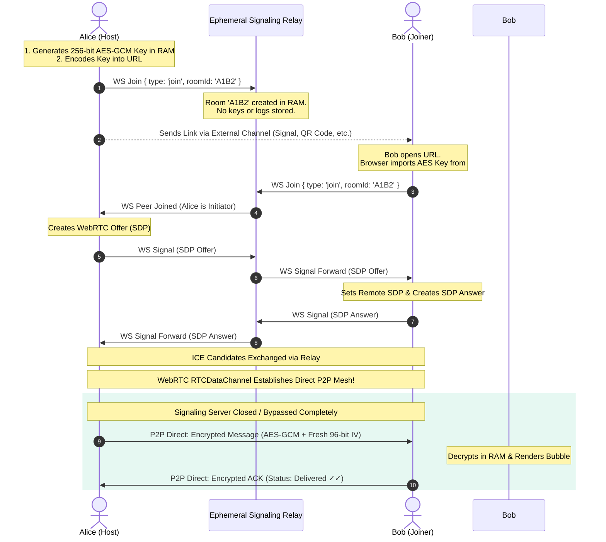

# 🔒 CryptLnk — Serverless Zero-Knowledge Ephemeral P2P Chat

[](LICENSE)
[](https://developer.mozilla.org/en-US/docs/Web/API/SubtleCrypto/encrypt)
[](https://developer.mozilla.org/en-US/docs/Web/API/RTCDataChannel)
[](https://datatracker.ietf.org/doc/html/rfc3986#section-3.5)
[-red.svg)]()
[](https://pranav-aitha.github.io/CryptLnk/)
[](https://github.com/pranav-aitha)

> **CryptLnk** is a completely serverless, zero-database, zero-login peer-to-peer ephemeral encrypted chat application. By leveraging the browser's native **Web Crypto API (AES-256-GCM)** and **WebRTC DataChannels**, CryptLnk establishes direct browser-to-browser tunnels. Cryptographic keys reside exclusively within the browser's URL `#hash` fragment and are **never transmitted to any server**, guaranteeing mathematical zero-knowledge privacy.

🌐 **Live GitHub Pages Demo**: [https://pranav-aitha.github.io/CryptLnk/](https://pranav-aitha.github.io/CryptLnk/)

---

## 📑 Table of Contents
1. [Core Architectural Philosophy](#-core-architectural-philosophy)
2. [The Zero-Knowledge URL Hash Paradigm](#-the-zero-knowledge-url-hash-paradigm)
3. [Cryptographic Security & Threat Model](#-cryptographic-security--threat-model)
4. [Protocol & WebRTC Handshake Flow](#-protocol--webrtc-handshake-flow)
5. [Key Features & User Experience](#-key-features--user-experience)
6. [Project Structure](#-project-structure)
7. [How to Run Locally](#-how-to-run-locally)
8. [Deployment to GitHub Pages](#-deployment-to-github-pages)
9. [Technologies & Frameworks Breakdown](#-technologies--frameworks-breakdown) *(Last 3rd of Document)*
10. [About the Author & Socials](#-about-the-author--socials)
11. [License](#-license)

---

## 💡 Core Architectural Philosophy

Modern messaging applications routinely market "end-to-end encryption" while quietly maintaining centralized user registries, phone number bindings, metadata ledgers, and contact graphs. Even if message plaintexts are encrypted, the server retains granular knowledge of **who is speaking to whom, when, and from which IP address**.

**CryptLnk fundamentally dismantles this surveillance model:**
- **Zero Registration / Zero Authentication**: No phone numbers, no emails, no usernames, no accounts.
- **Zero Databases**: No SQL, NoSQL, Redis, or cloud storage. Nothing is stored on disk anywhere.
- **Zero Local Persistence**: No `localStorage`, no `sessionStorage`, no cookies, no IndexedDB. The moment you refresh or close your browser tab, the cryptographic keys and chat history vanish forever from RAM.
- **Direct Peer-to-Peer DataChannels**: Once connection discovery completes, chat messages travel directly between the two peer browsers.
- **Emergency Room Burn**: A single click instantly wipes all cryptographic keys in memory, terminates the WebRTC peer connection, purges the DOM, and scrubs the URL hash.

---

## 🛡️ The Zero-Knowledge URL Hash Paradigm

The cornerstone of CryptLnk's zero-knowledge security is its exploitation of **RFC 3986 Section 3.5 (Uniform Resource Identifier Specification)**:

```
https://pranav-aitha.github.io/CryptLnk/#room=a7b9c1d3e5f7&key=a8Fd_9Xq...
                                        ▲
                                        └──── URI Fragment / Hash Identifier
```

### Why the Server Cannot Read Your Encryption Key:
1. **RFC 3986 Compliance**: According to the HTTP/1.1 and HTTP/2 standards, the URI fragment identifier (everything after `#`) is an exclusively **client-side construct**.
2. **Omission from Wire Protocol**: When your browser requests a web page, it sends the origin and path (`GET /CryptLnk/ HTTP/2`). The user-agent **never** sends the `#hash` portion across the wire in the HTTP request line or headers.
3. **Mathematical Proof of Zero Knowledge**: Neither the web hosting server, the CDN, reverse proxies, nor your ISP ever sees the cryptographic key. It is parsed strictly within your local browser execution sandbox via `window.location.hash`.

---

## 🔐 Cryptographic Security & Threat Model

### Authenticated Encryption with AES-256-GCM
CryptLnk utilizes Galois/Counter Mode (GCM) with 256-bit Advanced Encryption Standard (AES) keys through the native browser `window.crypto.subtle` API:

- **Key Generation**: 256 bits of high-entropy cryptographic randomness generated via CSPRNG (`window.crypto.subtle.generateKey`).
- **Initialization Vector (IV)**: A fresh 12-byte (96-bit) cryptographically random nonce generated via `crypto.getRandomValues(new Uint8Array(12))` for **every single message**. Nonce reuse is mathematically impossible.
- **Authentication Tag (GHASH)**: AES-GCM generates a 128-bit authentication tag appended to the ciphertext. If an active adversary tampers with a single bit in transit, the WebCrypto API rejects the packet during decryption, alerting both peers to tampering.
- **Safety Number Fingerprint**: Peers can visually verify their connection using a 16-character hexadecimal fingerprint derived from the SHA-256 hash of the shared raw AES key:
  $$\text{Fingerprint} = \text{SHA-256}(\text{RawKey}_{256})[0..16]$$

---

## 🔄 Protocol & WebRTC Handshake Flow

The diagram below details the entire ephemeral lifecycle from key creation to encrypted P2P messaging:



---

## ✨ Key Features & User Experience

- **Customizable Display Names & Cyber Aliases**: Pick or randomize display aliases (e.g. `Quantum_Falcon_42`) before joining or hosting, with encrypted P2P profile synchronization and in-chat renaming.
- **Client-Side Chat Transcript Export**: Download ephemeral chat records directly from browser RAM in Plain Text (`.txt`), GitHub-flavored Markdown (`.md`), or structured JSON (`.json`), or copy to clipboard with zero server surveillance.
- **Minimalist Dark Luxury UI**: Clean cyberpunk slate aesthetic engineered with Tailwind CSS. Distraction-free typography and smooth micro-interactions.
- **Instant QR Code Generator**: Offline, client-side QR matrix generated directly on a `<canvas>` element. Allows smartphones to join the encrypted session with zero network leaks.
- **Message Delivery Status**: Real-time delivery acknowledgments (`✓ Sent` and `✓✓ Delivered`) transmitted via encrypted P2P control frames.
- **Live Typing Indicator**: Real-time peer typing indicator animated with pulsing dots, encrypted over the RTCDataChannel.
- **Configurable Self-Destruct Timers**: Selectable message lifespans (Keep in RAM, 15s, 30s, 1m, 5m). Messages count down dynamically and are eradicated from the DOM and browser memory.
- **Emergency Room Burn**: Instantly closes the WebRTC channel, disconnects signaling, sets `cryptoKey = null`, scrubs the URL hash with `history.replaceState()`, and clears all DOM elements.
- **Real-Time Latency Monitor**: Continuous P2P ping/pong latency measurement directly between peer browsers.
- **Native Synthesizer Chimes**: Web Audio API waveform oscillator producing subtle futuristic auditory feedback for sent messages, incoming transmissions, and session burns with zero external sound files.
- **Air-Gapped Manual SDP Mode**: Complete serverless fallback mode allowing peers to exchange SDP offer/answer tokens manually without even needing a signaling server.
- **Cute Interactive Designer Footer**: Created with love by Pranav Aitha, featuring interactive floating heart particle explosions and styled social buttons.

---

## 📁 Project Structure

```
CryptLnk/
├── index.html              # Complete SPA UI & Vanilla JS client logic
├── server.js               # Lightweight Node.js WebSocket signaling relay
├── package.json            # Node.js manifest & dependencies
├── LICENSE                 # MIT Open Source License
├── README.md               # Comprehensive architectural documentation
├── schedule-release.ps1    # Automated scheduled release script
└── .gitignore              # Repository hygiene rules
```

---

## 💻 How to Run Locally

Because CryptLnk is built with standard web technologies and minimal overhead, setup takes less than 30 seconds:

### Prerequisites
- [Node.js](https://nodejs.org/) (v16.0.0 or higher recommended)
- Modern Web Browser (Google Chrome, Mozilla Firefox, Brave, Apple Safari, Microsoft Edge)

### Installation & Launch
```bash
# 1. Clone the repository
git clone https://github.com/pranav-aitha/CryptLnk.git
cd CryptLnk

# 2. Install dependencies (only 'ws' for the signaling relay)
npm install

# 3. Start the server
npm start
```

Open `http://localhost:3000` in your browser. 
- Click **"Generate Secure Link"**.
- Copy the generated URL into a second browser window or private tab.
- Watch the direct WebRTC DataChannel establish instantly!

---

## 🌐 Deployment to GitHub Pages

CryptLnk is engineered to run seamlessly as a static web application on GitHub Pages:

1. Push this repository to GitHub under your account (`https://github.com/<your-username>/CryptLnk`).
2. Navigate to **Settings** $\to$ **Pages**.
3. Under **Branch**, select `main` (or `master`) and folder `/ (root)`.
4. Click **Save**. Within 60 seconds, your site will be live at:
   `https://<your-username>.github.io/CryptLnk/`

> **Note on Signaling with GitHub Pages**: CryptLnk incorporates a dual-mode signaling engine. When deployed on GitHub Pages, it connects to a zero-knowledge serverless cloud signaling broker (PeerJS) so any two browsers anywhere on the web can connect instantly without running a local server. When self-hosting or running locally with `npm start`, it can also route discovery through the included Node.js WebSocket server (`server.js`). Additionally, the built-in **Air-Gapped Manual SDP Handshake** provides 100% serverless P2P communication without any signaling broker!

---

## 🛠️ Technologies & Frameworks Breakdown

CryptLnk rejects bloated single-page application frameworks (such as React, Angular, or Vue) in favor of standards-compliant, native browser performance and strict auditability. Below is the exhaustive inventory of all protocols, specifications, and libraries employed:

| Layer / Technology | Specification / Version | Role in Architecture |
| :--- | :--- | :--- |
| **Web Crypto API** | W3C Recommendation (`SubtleCrypto`) | Performs client-side CSPRNG key generation (`AES-GCM` 256-bit), authenticated encryption with 96-bit unique IVs, and SHA-256 safety fingerprint hashing. |
| **WebRTC 1.0** | W3C / IETF RFC 8829 | Manages peer connection state (`RTCPeerConnection`), local/remote session descriptions (`RTCSessionDescription`), and interactive candidate exchange. |
| **RTCDataChannel** | W3C Recommendation | High-throughput, low-latency, ordered bidirectional data transport directly connecting two browser sandboxes. Bypasses servers completely. |
| **STUN Protocol** | IETF RFC 5389 | Utilizes public Google STUN servers (`stun.l.google.com:19302`) for NAT traversal, discovering public reflexive IP/port mappings for P2P routing. |
| **URI Fragment Standard**| IETF RFC 3986 Section 3.5 | Guarantees that the `#room=...&key=...` cryptographic anchor is never transmitted over HTTP wire protocols to servers or CDNs. |
| **HTML5 & Vanilla ECMAScript** | ES2022+ Standard | Native DOM manipulation, memory closure isolation, async/await concurrency, and event handling without third-party runtime weight. |
| **Tailwind CSS** | v3.4 JIT Engine (CDN) | Modern utility-first CSS framework powering the responsive dark luxury aesthetic, glassmorphism filters, and CSS keyframe animations. |
| **PeerJS Engine** | v1.5.4 (CDN) | Zero-configuration serverless WebRTC signaling provider enabling instant, friction-free peer discovery across static hosting like GitHub Pages. |
| **WebSocket Protocol** | IETF RFC 6455 | Full-duplex ephemeral control channel for relaying initial WebRTC SDP offers, answers, and ICE candidate packets between peers. |
| **Node.js `ws` Engine** | v8.18.0 | High-performance, lightweight WebSocket server implementation handling zero-storage ephemeral room handshakes for self-hosted instances. |
| **Web Audio API** | W3C Standard | Real-time audio waveform synthesis (sine and sawtooth oscillators) providing feedback without external audio file requests. |
| **HTML5 Canvas 2D API** | W3C Standard | Dynamic client-side matrix rasterization rendering offline scannable QR codes in real-time. |
| **HTML5 Blob & File API** | W3C File API | Client-side in-memory file synthesis enabling instant, zero-server chat transcript downloads in `.txt`, `.md`, and `.json`. |

---

## 👨‍💻 About the Author & Socials

Crafted with ❤️ and an obsession with cryptographic privacy by **Pranav Aitha**.

Connect, follow, or explore more open-source security projects:
- 🐦 **X (formerly Twitter)**: [@PRANAV_AITHA](https://x.com/PRANAV_AITHA)
- 📸 **Instagram**: [@pranav_aitha](https://instagram.com/pranav_aitha)
- 🐙 **GitHub**: [@pranav-aitha](https://github.com/pranav-aitha)

---

## 📄 License

This project is licensed under the **MIT License** — see the [LICENSE](LICENSE) file for complete details.

```
Copyright (c) 2026 Pranav Aitha
```
